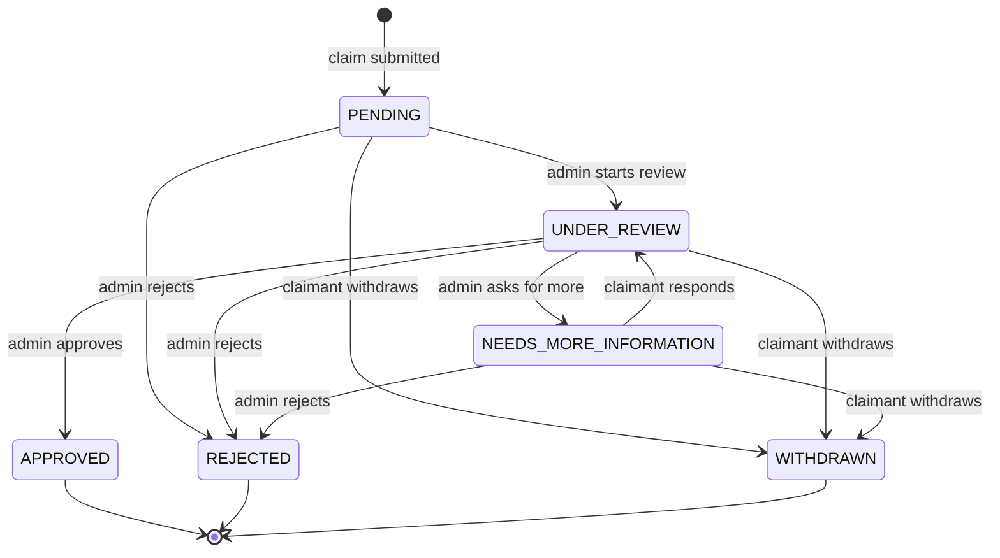

# Claim status flow

A claim is one person's request to be given one found item, supported by private evidence. Only the arrows below are allowed. The three bottom states are final.

Side effects (decided in [ARCHITECTURE.md](../ARCHITECTURE.md#7-status-flows)):

- Submitting a claim moves the found item to `UNDER_VERIFICATION`.
- Approving a claim moves the item to `APPROVED_FOR_RETURN` and automatically rejects every other active claim on that item.
- Only an administrator can approve or reject. Staff accounts cannot submit claims (conflict of interest).
