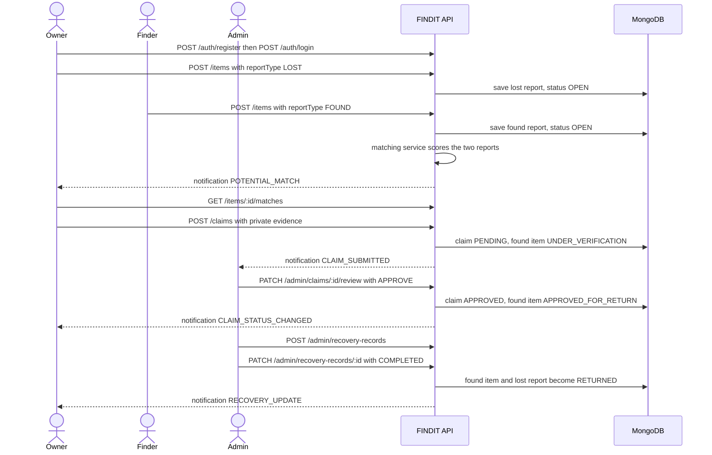

# End-to-end flow (the main demo scenario)

This is the full journey the final demonstration will walk through, and the first test that must pass at Stage 17:

**Register, log in, report lost, report found, potential match, claim, admin review, authorised recovery, final status.**

