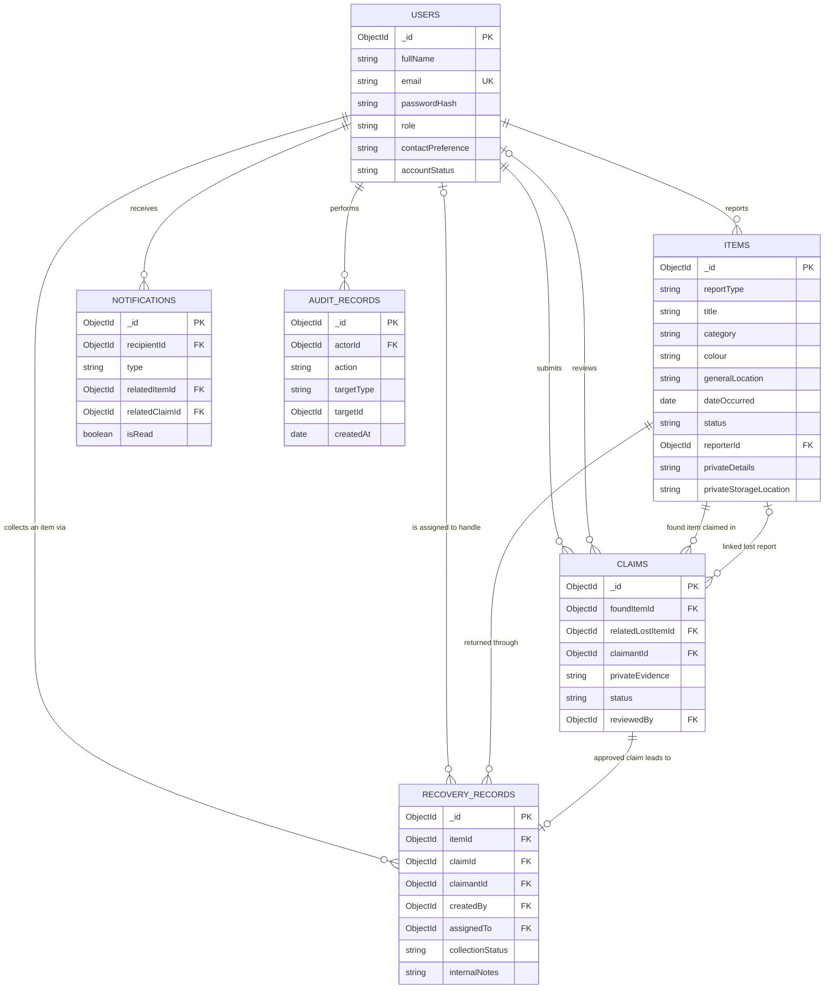

# Database relationship diagram (ER diagram)

Boxes are collections, lines are references (a stored `_id` pointing at a document in another collection). Field lists here are abbreviated; the full definitions, validation rules and indexes are in [DATABASE_SCHEMA.md](../DATABASE_SCHEMA.md).

