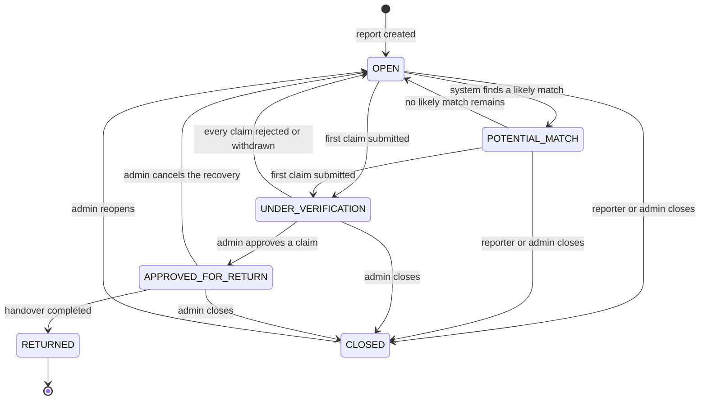

# Item status flow

Every report (lost or found) has one `status`. A status can only change along the arrows below; anything else is rejected by the backend with `INVALID_STATE_TRANSITION`. The full rules (who may trigger each arrow, and the conditions) are in the transition table in [ARCHITECTURE.md](../ARCHITECTURE.md#7-status-flows).

Notes:

- `UNDER_VERIFICATION` and `APPROVED_FOR_RETURN` only ever apply to **FOUND** items (claims are made on found items).
- A **LOST** report only uses `OPEN`, `POTENTIAL_MATCH`, `RETURNED` and `CLOSED`. It becomes `RETURNED` when the found item linked to the same claim is handed over.
- `RETURNED` is final.
