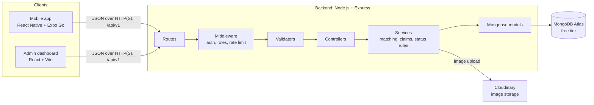

# System architecture diagram

Two clients (the phone app and the admin website) talk to **one** backend. Only the backend talks to the database and to the image service. Neither client ever touches MongoDB or Cloudinary directly, which is what keeps secrets and permissions under the backend's control.

Related: [ARCHITECTURE.md](../ARCHITECTURE.md)
